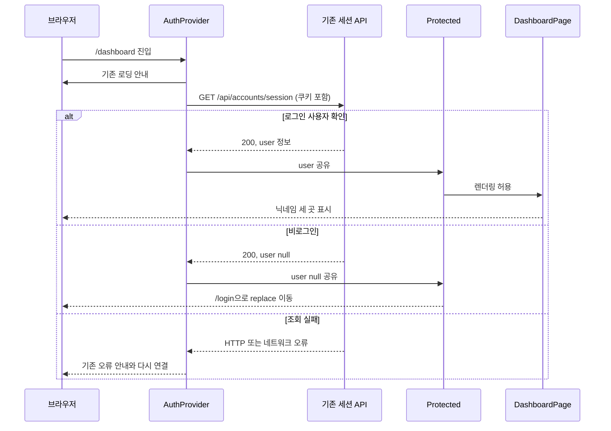

# 대시보드 로그인 닉네임 연동 SDD

작성일: 2026-10-23  
상태: 2026-10-24 구현·자동 테스트·모의 API 브라우저 검증 완료. 실제 Supabase 계정 연동 확인은 미수행.  
기준 계획: [dashboard-auth-plan.md](dashboard-auth-plan.md)  
관련 요구사항: [PRD.md](PRD.md)의 회원·계정 설정, [spec.md](spec.md)의 로그인·닉네임 변경, [plan.md](plan.md)의 추가 작업 기록

## 1. 문서 목적

SDD(Software Design Description)는 구현할 코드의 구조와 처리 방법을 정하는 소프트웨어 설계 문서입니다. 이번 문서는 계획에서 정한 닉네임 연동을 어느 컴포넌트에서, 어떤 데이터를 사용해, 어떻게 검사하며 구현할지 정의합니다.

이번 작업은 기존 회원 정보를 대시보드에서 읽는 프론트엔드 연결 작업입니다. 앞선 계획의 로그인 전용 화면 전환안을 설계 기준으로 구체화했습니다. 코드 조각은 구현 원리를 설명하는 요약이며, 실제 파일과 검증 결과는 11장을 참고합니다.

## 2. 설계 목표와 제외 범위

### 2.1 목표

- 로그인한 사용자의 닉네임을 대시보드의 인사말·왼쪽 계정명·아바타 첫 글자에 표시합니다.
- 대시보드와 계정 설정에서 하나의 인증 상태를 공유합니다.
- 로그인 확인 중, 로그인 성공, 비로그인, 조회 실패를 구분합니다.
- 기존 로그인 흐름과 Figma 대시보드의 배치를 유지합니다.

### 2.2 이번에 변경하지 않는 것

- 백엔드 API·입력 규칙·DB 테이블·Alembic·환경 변수·패키지 구성
- 로그인 성공 후 홈 `/`로 이동하는 기존 동작
- 대시보드의 날짜, 공부 기록·오류 수, 최근 기록과 할 일 예시 데이터
- 할 일 체크를 화면 안에서만 처리하고 새로고침하면 초기화하는 동작
- 버튼 색상·크기·활성 상태, 기존 메뉴 경로, 일반 화면의 공통 디자인
- Figma 원본, 실제 기록 데이터 연동, 새 메뉴·로그아웃·자동 갱신 기능

기존 계획과 마찬가지로 다른 탭에서 바뀐 닉네임이나 페이지를 열어 둔 동안의 세션 만료를 실시간 감지하지 않습니다. 새로고침 또는 기존 인증 조회 시점에 서버 상태를 반영합니다.

## 3. 현재 구조와 변경 후 구조

### 3.1 설계 당시 구조에서 해결할 부분 (2026-10-23)

설계 당시 `AppRoutes`는 `/dashboard`를 바로 렌더링했습니다. 나머지 경로만 `ExistingAppRoutes` 내부의 `AuthProvider`를 사용했습니다. 따라서 대시보드는 `useAuth()`를 사용할 수 없고 로그인 상태도 확인하지 않았습니다. 이 구조를 아래 설계에 따라 수정했습니다.

`AuthContext.jsx`에는 이미 다음 기능이 있습니다.

- 세션 조회와 사용자 상태 보관
- 로그인 성공 시 사용자 상태 갱신
- 닉네임 변경 성공 시 사용자 상태 갱신
- 로그인 상태 조회 중 안내와 조회 실패 시 재시도

새 인증 상태를 만들지 않고 이 기능을 공유합니다.

### 3.2 변경 후 컴포넌트 구성

```text
App
└─ BrowserRouter
   └─ AppRoutes
      └─ AuthProvider                  ← 하나만 유지
         └─ Routes
            ├─ /dashboard
            │  └─ Protected
            │     └─ DashboardPage    ← 자체 사이드바와 레이아웃
            └─ *
               └─ ExistingAppRoutes
                  └─ Layout           ← 기존 일반 화면의 레이아웃
                     └─ Routes
                        ├─ /login → LoginPage
                        ├─ /signup → SignupPage
                        ├─ / → Protected → HomePage
                        ├─ /settings → Protected → SettingsPage
                        └─ * → Protected → 기존 없는 페이지 안내
```

`ExistingAppRoutes`에서 `AuthProvider`만 제거합니다. 기존 `Layout`과 내부 경로는 유지합니다. 대시보드에는 `Layout`을 적용하지 않습니다.

`AppRoutes`는 계속 export하여 기존 `MemoryRouter` 기반 테스트가 같은 진입점을 사용할 수 있게 합니다. `BrowserRouter`를 추가로 만들거나 라우터를 중첩하지 않습니다.

### 3.3 라우팅 변경 지침

`App.jsx`의 목표 구조는 다음과 같습니다. 생략된 기존 내부 경로는 그대로 유지합니다.

```jsx
function ExistingAppRoutes() {
  return <Layout><Routes>{/* 기존 내부 Route 유지 */}</Routes></Layout>
}

export function AppRoutes() {
  return <AuthProvider><Routes>
    <Route path="/dashboard" element={<Protected><DashboardPage /></Protected>} />
    <Route path="*" element={<ExistingAppRoutes />} />
  </Routes></AuthProvider>
}
```

`Protected`의 기존 `user ? children : <Navigate to="/login" replace />` 처리를 재사용합니다. `AuthProvider`가 조회 완료 전에는 하위 화면을 렌더링하지 않으므로, 로딩 도중 사용자가 없다고 판단해 로그인 화면으로 이동하지 않습니다.

공유 제공자를 경로별로 생성하거나 `location.pathname`을 `key`로 지정하지 않습니다. 클라이언트 내부 경로 이동에서 제공자가 유지되어야 닉네임 변경 결과도 유지됩니다.

## 4. 데이터와 기존 API 계약

### 4.1 데이터의 책임

| 데이터 | 기준 위치 | 대시보드의 사용 방법 |
| --- | --- | --- |
| 회원 닉네임 | DB의 기존 회원 정보 | API 응답을 통해 간접적으로 읽음 |
| 로그인 사용자 | `AuthProvider`의 `session.user` | `useAuth().user`로 읽음 |
| 표시용 닉네임·첫 글자 | `DashboardPage`의 렌더링 계산 | 사용자 정보에서 매번 계산. 별도 상태로 저장하지 않음 |
| 할 일 체크 | `DashboardPage`의 기존 로컬 상태 | 기존 처리 유지 |

대시보드는 사용자 ID를 받아 다른 회원을 조회하지 않습니다. 세션에 해당하는 본인 정보만 표시합니다. 닉네임을 URL, 별도 전역 저장소, localStorage 또는 sessionStorage에 추가로 저장하지 않습니다.

### 4.2 재사용하는 API

| 메서드·경로 | 호출 주체 | 관련 요청·응답 | 적용 방법 |
| --- | --- | --- | --- |
| `GET /api/accounts/session` | 기존 `AuthProvider` → `accounts.readSession()` | 요청 본문 없음. 성공 `200`: `user`와 `csrf_token`. `user`는 회원 정보 또는 `null` | 최초 진입·새로고침·기존 재시도에 사용 |
| `POST /api/accounts/login` | 기존 로그인 화면 → 인증 컨텍스트 | 이메일·비밀번호 JSON. 성공 `200`: 사용자와 새 CSRF 정보 | 기존 컨텍스트 갱신 유지. 성공 후 `/` 이동 유지 |
| `PATCH /api/accounts/me` | 기존 계정 설정 → `changeNickname()` | 닉네임 JSON. 성공 `200`: 변경된 회원 정보 | 반환된 회원 정보로 컨텍스트의 `user` 갱신 |

화면이 읽는 회원 정보 계약은 `id: number`, `email: string`, `nickname: string`입니다. 닉네임은 기존 서버 규칙인 2~20자, 한글·영문·숫자·밑줄을 따릅니다. 이번 작업에서 입력 규칙이나 응답 스키마를 변경하지 않습니다.

비로그인·만료된 쿠키·삭제된 회원의 세션 조회는 기존 로직에 따라 `200`과 `user: null`로 처리됩니다. 네트워크 오류나 서버의 `503`을 `user: null`로 바꾸지 않습니다. `GET /api/accounts/me`를 대시보드에서 추가 호출할 필요는 없습니다.

요청의 `credentials: 'include'`, 8초 제한과 안전한 오류 안내는 기존 `api/client.js`를 사용합니다. 쿠키·CSRF 값은 기존 코드가 처리하고 문서나 로그에 실제 값을 남기지 않습니다.

## 5. 화면 진입과 상태 처리



| 상태 | 기존 내부 값 | 렌더링 기준 | 재시도·이동 |
| --- | --- | --- | --- |
| 조회 중 | `loading=true` | 기존 `connection-screen` | 완료 전 대시보드·일반 경로 렌더링 안 함 |
| 로그인 | `loading=false`, 오류 없음, `user` 있음 | `Protected`가 대시보드 허용 | 기존 링크로 이동 |
| 비로그인 | `loading=false`, 오류 없음, `user=null` | 대시보드 렌더링 안 함 | `/login`, `replace` |
| 조회 실패 | `loading=false`, `error` 있음 | 기존 오류 화면 | 기존 다시 연결 버튼으로 조회 재시도 |

이 표는 기존 상태를 설명하기 위한 구분이며 새 상태 변수나 별도 상태 관리 도구를 추가하라는 뜻이 아닙니다. 사용자 없음과 조회 실패를 하나로 합치지 않습니다.

## 6. 닉네임 표시 설계

### 6.1 DashboardPage의 변경

기존 `useState`와 체크 처리에 더해 `useAuth`를 import합니다. `Protected` 안에서만 렌더링된다는 전제에서 다음 표시값을 계산합니다.

```jsx
const { user } = useAuth()
const nickname = user.nickname
const avatarInitial = Array.from(nickname)[0]
```

| 위치 | 변경할 표현 |
| --- | --- |
| 인사말 `<h1>` | `{nickname}님, 차곡차곡 쌓이고 있어요` |
| 계정명 `<strong>` | `{nickname}`. 필요한 경우 `title={nickname}` 부여 |
| 아바타 | `{avatarInitial}`. 기존 `aria-hidden="true"` 유지 |

아바타는 옆 계정명이 사용자 이름을 전달하므로 중복해서 읽히지 않도록 합니다. 계정명은 DOM에 전체 닉네임을 유지하며 CSS로만 말줄임합니다.

고정 문자열 `이월님`, `이월`, `이`는 해당 세 표시에서 제거합니다. 서버가 보낸 정상 사용자 정보를 그대로 표시하고 임시 이름으로 대체하지 않습니다. 임의 HTML 삽입은 사용하지 않습니다.

### 6.2 닉네임 변경 후 반영

1. 계정 설정이 기존 `changeNickname()`을 호출합니다.
2. 서버가 변경된 회원 정보를 반환하면 기존 `AuthProvider`가 `session.user`를 갱신합니다.
3. 같은 제공자 아래의 대시보드로 이동하면 현재 `user.nickname`을 읽습니다.
4. 문서 전체를 새로고침한 경우에는 세션 API에서 현재 닉네임을 다시 읽습니다.

별도 이벤트, 대시보드 전용 캐시 무효화, 추가 조회, 저장 성공 전 화면 이름을 미리 바꾸는 처리는 추가하지 않습니다. 닉네임 변경 실패 시 기존 정상 사용자 정보가 유지됩니다. 기존 401·403 발생 시 인증 재조회 처리도 그대로 사용합니다.

로그인 성공 후 이동은 `/` 그대로입니다. 로그인 전 주소로 자동 복귀하는 로직과 계정 설정의 새 대시보드 링크는 이번에 추가하지 않습니다.

## 7. 이름 길이와 스타일 설계

변경은 CSS Modules의 닉네임 관련 규칙으로 제한합니다. 기존 색상·폰트 크기·버튼 치수·브레이크포인트를 유지하며 다음 보완이 필요한지 구현 시 확인합니다.

| 대상 | 보완 지침 | 목적 |
| --- | --- | --- |
| `.accountLabel` | `min-width: 0`, `flex: 1` | 긴 이름이 계정 영역을 밀어내지 않게 함 |
| `.accountLabel strong` | `overflow: hidden`, `text-overflow: ellipsis`, `white-space: nowrap` | 좁은 계정명 영역에서 말줄임. 실제 문자열은 자르지 않음 |
| `.greeting > div` | `min-width: 0`, `flex: 1` | 작성 버튼을 제외한 사용 가능한 너비 안에서 인사말 배치 |
| `.greeting h1` | 필요하면 `overflow-wrap: anywhere` | 공백 없는 긴 영문·숫자 닉네임도 줄바꿈 |

아바타는 기존 크기와 배경을 유지합니다. 인사말 영역의 높이는 내용에 따라 늘어날 수 있게 하며 제목을 가리거나 자르지 않습니다. 데스크톱에서는 기존 버튼과 함께 배치하고 좁은 화면에서는 기존 줄바꿈 규칙을 사용합니다.

`base.css`, 일반 화면의 공통 `Layout`, 공부 기록 쓰기 버튼의 `#D92D20` 배경과 비활성 상태는 변경하지 않습니다.

## 8. 파일별 구현 명세

| 파일 | 작업 | 주의할 점 |
| --- | --- | --- |
| `frontend/src/App.jsx` | 제공자를 `AppRoutes`의 공통 상위로 이동. 내부 중복 제공자 제거. `/dashboard`에 `Protected` 적용 | 기존 내부 경로·기본 이동·레이아웃 유지 |
| `frontend/src/pages/dashboard/DashboardPage.jsx` | `useAuth()` 사용과 세 위치의 닉네임 치환 | 예시 데이터·체크 처리·API 호출 추가 없음 |
| `frontend/src/pages/dashboard/DashboardPage.module.css` | 7장의 범위에서 긴 이름 관련 스타일 보완 | 공통 선택자와 다른 카드 스타일 수정 없음 |
| `frontend/src/tests/DashboardPage.test.jsx` | 인증 세션 기반으로 기존 테스트 전제 교체. 닉네임·오류·상태·예시 기능 검사 | 실제 백엔드나 DB에 요청하지 않음 |
| `frontend/src/tests/accounts/AuthFlows.test.jsx` | 대시보드 접근 보호와 닉네임 변경 후 경로 이동 검사 보완 | 기존 가입·로그인 테스트 유지 |
| `docs/setup.md` | `/dashboard`가 로그인 필요 화면으로 바뀌는 점과 실행 안내 갱신 | 과거 예시 페이지 안내와 현재 조건을 구분 |
| `docs/plan.md` | 완료·미확인·다음 할 일 기록 | 설계만으로 구현 완료 처리하지 않음 |

기존 `AuthContext.jsx`, API 호출 모듈과 백엔드는 재사용하며 현재 설계에서는 수정이 필요하지 않습니다. 별도 패키지·새 공통 컴포넌트·신규 API 파일도 만들지 않습니다.

## 9. 테스트 상세 설계

### 9.1 테스트 구성

- 기존 Vitest·React Testing Library·`MemoryRouter`와 export된 `AppRoutes`를 사용합니다.
- 기존 회원 테스트처럼 `accounts.readSession`, `login`, `changeNickname`을 가짜 응답으로 대체합니다.
- 고정 응답, 나중에 resolve하는 Promise, reject하는 Promise로 성공·대기·실패를 재현합니다.
- API 모의 호출과 실제 `fetch` 검사를 구분합니다. API 모듈을 모의 처리한 테스트는 실제 HTTP 호출 횟수를 증명했다고 기록하지 않습니다.
- StrictMode의 중복 마운트는 기존 `readSession()`의 진행 중 요청 공유가 처리합니다. 모든 환경에서 무조건 한 번만 호출된다고 가정하지 않습니다. 대시보드 자체의 추가 조회가 없고, 제공자가 유지되는 내부 경로 이동에서 불필요한 재조회가 없는지 확인합니다.

### 9.2 자동 테스트 항목

| ID | 준비·행동 | 검증 |
| --- | --- | --- |
| D01 | A 사용자 세션으로 `/dashboard` 렌더링 | 인사말·계정명·아바타가 A의 닉네임. 고정 예시 이름 없음 |
| D02 | 별도 렌더링에서 B 사용자 세션 제공 | A의 이름이 남지 않고 B의 닉네임 표시 |
| D03 | 세션 Promise를 미완료 상태로 유지 후 resolve | 대기 중 로딩 안내. 예시 이름·대시보드·조기 로그인 이동 없음. 완료 후 사용자 표시 |
| D04 | `user: null` 응답 | `/login` 이동. 대시보드 내용 없음 |
| D05 | 조회 reject 후 다시 연결, 성공 응답 | 오류 표시. 실패를 비로그인으로 처리하지 않음. 재시도로 복구 |
| D06 | 동일 `MemoryRouter`·제공자에서 대시보드 → 계정 설정 → 변경 성공 → 브라우저 뒤로 이동 | 변경된 닉네임·아바타 표시. 제공자 재생성으로 이전 이름 복원 없음 |
| D07 | 닉네임 변경 실패 후 대시보드로 이동 | 기존 정상 닉네임 유지 |
| D08 | 컴포넌트 트리를 새로 마운트하고 현재 서버 세션 응답 제공 | 닉네임은 서버 응답 기준. 할 일 체크는 초기화 |
| D09 | 2자·20자와 한글·영문·숫자·밑줄을 포함한 정상 닉네임 | 문자열과 첫 글자 정확. 실패 시 임의 이름 대체 없음 |
| D10 | 할 일 체크·해제·모두 완료 | 기존 남은 개수·완료율 변경 유지. 추가 저장·변경 API 호출 없음 |
| D11 | 기존 메뉴·버튼 검사 | 링크는 기존 경로, 없는 기능의 비활성 상태 유지 |
| D12 | 기존 가입·로그인·홈·설정 테스트 실행 | 접근 규칙·입력 처리·로그인 성공 후 `/` 이동 유지 |

D06의 테스트용 위치 표시·뒤로 이동 제어는 테스트 코드에만 둡니다. 이 검사를 위해 제품 화면에 새 버튼을 추가하지 않습니다. D08의 재마운트 검사는 브라우저 새로고침 확인과 구분해서 기록합니다.

### 9.3 빌드와 브라우저 검사

`frontend` 폴더에서 실행합니다.

```powershell
npm.cmd run test -- --run
npm.cmd run build
```

- Chrome 1440px과 360px 너비에서 2~20자 닉네임의 인사말·계정명·아바타를 확인합니다. 실제 줄바꿈·말줄임·가로 넘침은 jsdom 테스트로 확인했다고 처리하지 않습니다.
- 로그인 → 대시보드 → 계정 설정 변경 → 대시보드 → 새로고침으로 현재 이름이 유지되는지 확인합니다.
- 비로그인 브라우저와 API 차단 상황의 이동·오류 안내를 구분해 확인합니다.
- 네트워크에서 기존 세션 조회 외 대시보드 전용 회원 조회나 예시 할 일 저장 요청이 추가되지 않는지 확인합니다. 기존 홈의 `/api/health` 같은 요청은 대시보드 요청과 구분합니다.
- 실서버 확인이 불가능하면 모의 응답 검증과 빌드까지만 완료로 기록하고 실제 DB 연동 확인은 남은 일로 표시합니다. 기존 계정의 닉네임을 변경하는 수동 확인은 사용자가 허용한 테스트 계정으로 수행합니다.

## 10. 구현 순서와 완료 조건

1. 기존 코드와 프론트엔드 테스트의 기준 결과를 확인합니다.
2. `App.jsx`의 제공자 위치를 옮기고 접근 보호를 연결합니다.
3. 대시보드의 닉네임 세 곳과 긴 이름 스타일을 연결합니다.
4. D01~D12의 관련 테스트를 보완하고 전체 프론트엔드 테스트·빌드를 실행합니다.
5. 범위 내 브라우저 확인을 마친 뒤 실행 안내와 진행 기록을 갱신합니다.

완료로 판단하려면 닉네임 세 곳, 로그인 보호, 변경 후 상태 공유, 새로고침 후 서버 값 표시, 예시 기능 유지, 회귀 테스트와 빌드, 데스크톱·좁은 화면 확인 결과가 있어야 합니다. 확인하지 못한 실서버·브라우저 범위는 분리해 보고합니다.

2026-10-23 SDD 작성 단계에서는 기존 파일·API 계약·계획과 설계의 일치 여부만 확인했습니다. 이후 구현 결과는 아래와 같습니다.

## 11. 구현·검증 결과 (2026-10-24)

- `App.jsx`에 공통 `AuthProvider`와 대시보드의 `Protected`를 적용했습니다. 기존 인증 컨텍스트와 API 호출 모듈은 수정 없이 재사용했습니다.
- `DashboardPage.jsx`의 인사말·계정명·아바타를 `user.nickname`에 연결했습니다. CSS Modules에서 긴 계정명의 말줄임과 인사말 줄바꿈만 보완했습니다. 모바일에서는 인사말 아래에 기존 작성 버튼을 유지합니다.
- 기존 기준 테스트 24개를 먼저 통과한 뒤 관련 테스트를 보완했습니다. 최종 프론트엔드 테스트 36개와 프로덕션 빌드가 통과했습니다. D01~D12 범위의 닉네임·상태·화면 이동·기존 기능을 검사했습니다.
- 모의 API를 사용한 실제 Chrome에서 1440px·360px 너비와 2자·20자 한글·영문 닉네임의 가로 넘침·계정명 표시를 확인했습니다. 기존 버튼의 배경색 `#D92D20`과 비활성 상태도 유지됩니다.
- 같은 브라우저에서 계정 설정의 닉네임 변경 응답 → 뒤로 이동 → 변경된 이름 표시를 확인했습니다. 내부 이동으로 세션 조회가 추가되지 않았습니다. 실제 페이지 새로고침 시 서버 역할의 모의 API 응답에서 닉네임을 다시 읽고 체크 상태는 초기화됐습니다.
- 비로그인 세션의 `/login` 이동, 로그인 성공 후 기존 홈 이동, 연결 실패의 오류 표시와 다시 연결을 확인했습니다. 모의 HTTP 응답을 브라우저에서 직접 처리했으며 실제 백엔드·DB로 전달하지 않았습니다.
- 미확인: 실제 Supabase 계정으로 가입·로그인·닉네임 변경, Edge·Safari와 실제 휴대폰. 실서버 검증을 완료했다고 표시하지 않습니다.
- 백엔드·DB·환경 변수·패키지·Figma 원본은 변경하지 않았습니다. commit·push도 하지 않았습니다. 다음 확인은 기존 계정 로그인 후 `/dashboard`를 직접 열어 실제 닉네임을 확인하는 것입니다.
