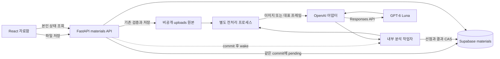
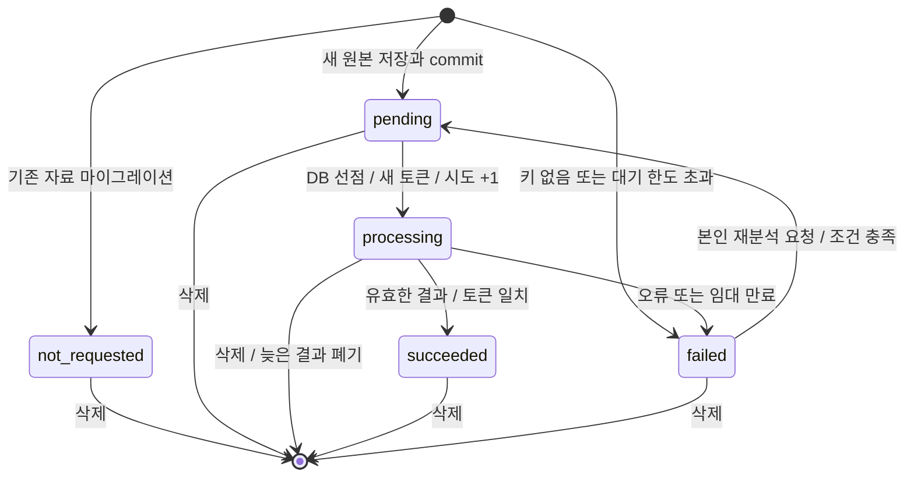
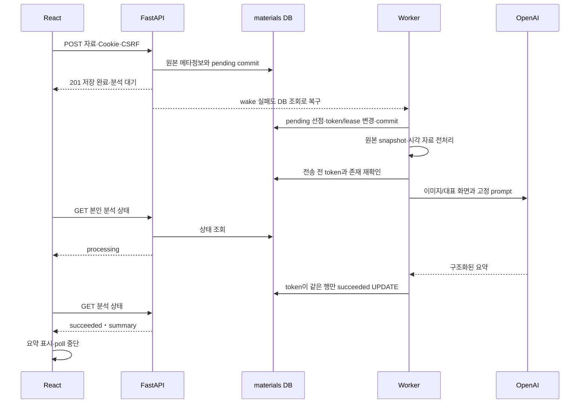

# BuildLog 학습 자료함 AI 요약 SDD

작성일: 2026-10-24

## 1. 문서 목적과 설계 범위

이 문서는 [자동 AI 요약 계획](materials-ai-plan.md)을 실제 구현 가능한 모듈·데이터·API·상태 전환·검증 규칙으로 구체화합니다. PRD 13절, SPEC 16절, PLAN 24절과 기존 보관 기능 M1~M5를 기준으로 합니다.

**구현 상태(2026-10-25):** AI1~AI6의 코드·패키지·DB 준비와 모의 통합 검증을 수행했습니다. 실제 Supabase에 0003을 적용했습니다. 유료 OpenAI 호출·실제 한국어 품질/비용은 키 입력 후 확인합니다. [실행 안내](materials-ai-setup.md)에 검증 범위를 구분했습니다. 아래 ‘현재/예정’ 설명 중 변경 전 구조는 설계 작성 시점의 기준입니다.

**확정 범위**

- 새 PNG/JPG 이미지 또는 MP4 영상 저장 후 자동으로 한국어 요약을 생성합니다.
- 영상은 **최대 8장의 대표 화면만** 분석합니다. 음성은 추출·전사하지 않습니다.
- 원본과 사용자 제목·메모는 유지하고 요약은 같은 materials 행에 별도로 저장합니다.
- 원본 저장과 요약의 성공/실패는 별개입니다. 기존 본인 전용 권한과 로그인·CSRF를 유지합니다.
- 기존 실행 준비 완료 후 사용자의 새 필수 입력은 backend/.env의 OPENAI_API_KEY 하나입니다. 모델·프롬프트·작업자는 개발자가 준비합니다.
- 과거 자료 일괄 분석, 요약 편집·대화·검색·음성 분석·이미지 생성은 추가하지 않습니다. 실패 재분석은 계획에 포함된 최소 복구 기능으로 제한합니다.

## 2. 현재 구조와 변경 경계

현재 실제 흐름은 다음과 같습니다.

```text
React MaterialsWorkspace.submit
  → materialsApi.uploadMaterial(FormData, 쿠키, CSRF)
  → POST /api/materials
  → CurrentUser + DatabaseSession + require_csrf
  → run_in_threadpool(create_material)
  → 원본 검증/임시 저장 → Material 추가/flush → 파일 게시 → commit
  → MaterialOutput, 201 → React 목록 반영
```

| 현재 코드 | 변경 지침 |
| --- | --- |
| `app/materials/services.py:create_material` | commit 전 분석 초기 상태를 함께 기록. 기존 원본 보상 로직 유지 |
| `app/materials/router.py:upload_material` | 원본 저장 성공 후 worker.wake를 호출하되 신호 실패 때문에 201을 실패로 바꾸지 않음 |
| `app/main.py:create_app`의 lifespan | 기존 DB 엔진 준비 뒤 AI 런타임 준비. 작업자 정리 후 엔진 dispose |
| `app/materials/models.py:Material` | 기존 테이블에 분석 컬럼 추가. users/원본 컬럼 보존 |
| `app/materials/schemas.py` | 기존 파일 응답 필드를 유지하고 analysis 객체 추가 |
| `app/materials/responses.py` | 기존 PrivateMaterialRoute와 private/no-store 유지 |
| `frontend/.../MaterialsPage.jsx` | 업로드 201 후 목록 반영 유지. 요약 상태 별도 표시·폴링 추가 |
| `frontend/src/auth/AuthContext.jsx` | 기존 withSession/refreshSession 그대로 재사용. 새 인증 체계 없음 |

설계 당시 head는 `0002_materials`였고 구현 후 head는 `0003_material_analysis`입니다. 기존 revision은 수정하지 않았습니다.

## 3. 전체 구조



- API 요청과 분석은 같은 프로세스에서 시작하지만 수명과 DB 세션을 공유하지 않습니다.
- 별도 Redis/Celery·OS FFmpeg 경로 설정·워커 실행 명령은 요구하지 않습니다.
- DB의 pending 행이 작업의 근거입니다. 메모리 Event는 즉시 깨우는 보조 신호입니다.
- 외부 호출 중 DB 트랜잭션·행 잠금을 유지하지 않습니다.
- 지원 기준은 현재의 백엔드 단일 실행 프로세스입니다. 여러 프로세스에서 같은 작업의 중복 선점도 방지하되 서버 전체 동시 수 제한은 별도 운영 검증이 필요합니다.

### 3.1 모듈과 인터페이스

| 파일/모듈 | 책임·예정 인터페이스 |
| --- | --- |
| `analysis_client.py` | `OpenAISummarizer.summarize(job, prepared)`, SDK 호출·고정 PROMPT·사용자 입력 분리·오류 분류 |
| `analysis_media.py` | `prepare(root, job)`와 모듈 최상위 `_decode`, Windows spawn 자식·자원 감시·snapshot/파생 파일 정리 |
| `analysis_worker.py` | `start()`, `wake()`, `stop()`, pending 선점·전처리·SDK·조건부 결과 저장·만료 정리 |
| `analysis_repository.py` | 분석 초기화/선점/CAS 갱신/재분석 예약/만료 정리. 모든 작업은 짧은 독립 Session 사용 |
| `analysis_schemas.py` | 상태 enum·내부 DTO·요약 출력·공개 analysis 객체·안전한 오류 코드 |
| 기존 services/router | 업로드 초기 상태·commit 후 신호, 본인 상태 GET·재분석 POST만 확장 |
| `frontend/.../useMaterialAnalysis.js` | 화면 수명에 맞춘 상태 조회와 폴링. UI에서 작업자 실행/키 관리 안 함 |

DTO에는 DB Session·Request·User ORM 인스턴스를 담지 않습니다. 작업자는 id/owner_id/저장용 이름/제목/메모/작업 토큰의 불변 스냅샷을 받습니다. Worker는 공개 응답을 만들지 않고 Repository는 OpenAI를 호출하지 않습니다.

## 4. 설정과 실행 수명

### 4.1 설정 기본값

다음은 SDD의 구현 기본값입니다. 운영 측정 후 조정할 수 있지만 사용자의 필수 입력으로 만들지 않습니다.

| 설정 | 기본값/처리 |
| --- | --- |
| OPENAI_API_KEY | `SecretStr("")`, backend/.env에서만 읽음. 빈 값이 서버 전체 시작 실패를 일으키지 않음 |
| OPENAI_MODEL | `gpt-6-luna`, 선택적 재정의. 모델 불가 시 비싼 모델로 자동 변경하지 않음 |
| reasoning.effort | `none` |
| max_output_tokens | 800 |
| SDK timeout / max_retries | 45초 / 0 |
| 이미지 긴 변 / 영상 프레임 긴 변 | 최대 1,536px / 1,024px |
| 대표 프레임 최대 수 | 8 |
| 파생 이미지 합계 | 최대 4MiB, 초과 시 품질/크기를 제한하고 불가능하면 분석 실패 |
| 전처리 예산 | 부모의 단조 시계 기준 15초, 자식 RSS 상한 기본 512MiB, 입력 최대 4,000만 픽셀 |
| 작업 전체 예산 / 임대 | 75초 / 90초. 전처리·SDK·결과 저장 여유를 포함 |
| 작업자 조회 / 만료 정리 | 대기 시 약 2초, 다음 선점 전에 만료 처리. 처리 중인 작업은 최대75초 예산 |
| 동시 처리 | 현재 프로세스 1개, 작성자당 processing 1개 |
| 사용자별 대기 한도 | pending 2개 제안. 초과 자료는 원본을 보관하고 failed/queue_full로 안내 |
| 실제 분석 시도 상한 | 자료당 최대 3회. SDK 자동 재시도와 별개 |
| 화면 폴링 | 3초 간격, 요청 중 중첩 금지, 표시 중 세션에서 최대 2분 |

전처리 RSS 측정은 크로스 플랫폼 측정 도구(psutil 등)를 AI1에서 호환 버전으로 준비합니다. 설정값은 0·음수·터무니없는 크기를 거절하고, 키의 유효성은 문자열 모양만으로 보장하지 않습니다. 위 제한은 분석에만 적용하며 기존 원본 업로드 허용량을 줄이지 않습니다.

### 4.2 lifespan 순서

1. 기존 Settings와 DB engine을 만듭니다. test 모드에서는 AI 작업자를 기본 비활성으로 하며 명시적으로 주입한 가짜 런타임만 실행합니다. 실제 환경의 키를 테스트가 가져가지 않습니다.
2. 설정을 전달해 OpenAI 클라이언트를 생성합니다. 키가 없으면 원본 기능만 유지하는 disabled 런타임을 사용합니다. SDK가 .env를 자동으로 읽는다고 가정하지 않습니다.
3. 작업자가 필요한 분석 컬럼을 사용할 수 있는지 확인합니다. DB 장애/미적용을 비밀값 없는 AI 준비 상태로 기록하고 tight retry loop를 만들지 않습니다. DB 스키마 자동 변경은 하지 않습니다.
4. 작업자는 서버 시작 시 pending을 찾고 만료 processing을 정리합니다. not_requested/failed 자료를 일괄 재분석하지 않습니다.
5. 종료 시 새 선점을 멈추고 작업에 최대 10초의 정리 시간을 줍니다. 남은 전처리 프로세스를 종료·join하고 SDK 요청을 취소합니다. 토큰이 여전히 일치하면 failed/interrupted로 기록을 시도합니다.
6. SDK 클라이언트를 닫고 전처리 임시 파일을 정리한 뒤 DB engine을 dispose합니다. 강제 종료로 DB 갱신이 불가능했으면 다음 시작의 임대 만료 정리가 처리합니다.

OpenAI 접속 불가가 회원가입·로그인·원본 보기의 시작 자체를 막으면 안 됩니다. 다만 새 코드에 필요한 DB 마이그레이션은 배포 전 준비해야 합니다. 기존 DB 설정 누락을 SQLite로 우회하지 않습니다.

## 5. 데이터 모델과 제약

### 5.1 추가 컬럼

| 컬럼 | SQLAlchemy 제안 형식 | 초기값/의미 |
| --- | --- | --- |
| analysis_status | String(20), NOT NULL | 서버 default `not_requested` |
| analysis_summary | Text, nullable | 성공한 요약 1~2,000자 |
| analysis_error_code | String(64), nullable | 고정된 내부 분류 코드만 저장 |
| analysis_model | String(100), nullable | 실제 선점 시점의 모델 |
| analysis_prompt_version | String(40), nullable | `materials-summary-v1` |
| analysis_started_at | DateTime(timezone=True), nullable | 최근 시도 시작 UTC |
| analysis_completed_at | DateTime(timezone=True), nullable | 최근 성공/실패 완료 UTC |
| analysis_job_token | String(36), nullable | 선점마다 새 UUID, 공개하지 않음 |
| analysis_lease_expires_at | DateTime(timezone=True), nullable | 현재 processing의 만료 시각 |
| analysis_attempt_count | Integer, NOT NULL | default 0, 외부 분석 시도 선점 횟수 |
| analysis_version | Integer, NOT NULL | default 0, 모든 상태 전환마다 +1 |
| analysis_input_tokens | BigInteger, nullable | 응답 usage가 있을 때만 저장 |
| analysis_output_tokens | BigInteger, nullable | 응답 usage가 있을 때만 저장 |
| analysis_metadata | JSON, nullable | 종류·프레임 시각/크기 등 제한된 메타정보 |

analysis_version은 기존 계획의 작업 토큰을 프론트에 공개하지 않고 오래된 폴링 응답을 구분하기 위한 세부 설계입니다. 기존 요약·상태 요구 범위에 포함되는 내부 제어값입니다.

### 5.2 상태 일관성

- status는 not_requested/pending/processing/succeeded/failed만 허용합니다.
- attempt_count는 0~3, version은 0 이상, usage는 null 또는 0 이상입니다.
- succeeded이면 trim한 summary가 1~2,000자이고 error_code는 null, completed_at은 필수입니다.
- succeeded 이외는 summary가 null입니다. 실패 내용을 요약에 쓰지 않습니다.
- failed이면 error_code·completed_at이 필수입니다. pending은 error_code·completed_at이 null입니다.
- processing이면 job_token·started_at·lease_expires_at이 필수입니다. 그 외에는 job_token과 lease를 null로 지웁니다. 완료 시 토큰은 제거해 재사용하지 않습니다.
- `(analysis_status, created_at, id)`, `(owner_id, analysis_status)`, 만료 조회용 `(analysis_status, analysis_lease_expires_at)` 인덱스를 제안합니다. 기존 인덱스·고유 저장명·작성자 외래키는 유지합니다.
- 기존 행은 not_requested/attempt_count=0/version=0으로 보존합니다. 새 업로드는 pending/version=1 또는 설정 불가에 따른 failed/version=1을 명시합니다.
- 재분석 예약 시 이전 실패·완료일·usage·파생 메타정보를 정리하되 attempt_count는 유지합니다. 이전 분석의 전체 이력을 새 테이블로 보관하는 기능은 범위 밖입니다.

### 5.3 마이그레이션

`0003_material_analysis`에서 컬럼·제약·인덱스를 추가합니다. PostgreSQL은 ALTER, 테스트 SQLite는 필요한 부분에 Alembic batch를 사용합니다. 기존 행을 보존하고 반복 upgrade 무변경을 확인합니다. 기존 materials RLS와 직접 접근 제한은 그대로 유지합니다. downgrade는 분석 정보가 사라지므로 테스트 DB에서만 검증합니다.

## 6. 상태 전환과 중복 실행 방지



### 6.1 업로드 시 초기화

기존 create_material의 트랜잭션 안에서 현재 작성자 행을 잠깐 잠그고 대기 수를 확인합니다. 키가 없으면 failed/missing_key, 대기 한도 초과면 failed/queue_full, 나머지는 pending으로 저장합니다. 이 두 사전 실패는 외부 요청을 하지 않았으므로 attempt_count=0입니다.

요청에 사용 중인 Session/UploadFile을 worker에 넘기지 않습니다. create_material은 이전과 같이 MaterialOutput을 준비하고 파일 게시·commit 후 반환합니다. router는 반환 후 worker.wake를 실행합니다. wake에서 오류가 나도 원본 commit을 롤백하거나 클라이언트에 저장 실패를 반환하지 않습니다. DB polling이 누락된 신호를 보완합니다.

### 6.2 선점 트랜잭션

1. 오래된 pending 후보를 소수 조회합니다. 후보 조회는 잠금을 오래 잡지 않습니다.
2. 독립 트랜잭션에서 **users 작성자 행→materials 작업 행** 순서로 잠급니다. 사용자별 대기/선점/재분석 예약에서 같은 순서를 지켜 교착을 줄입니다.
3. PostgreSQL은 skip_locked를 사용하고 작성자의 processing 작업이 있으면 건너뜁니다. SQLite 테스트에서는 단일 작업자를 기본으로 하되 `UPDATE ... WHERE status='pending' AND version=:observed` 행 수 검사로 중복 획득을 막습니다.
4. 키 존재·시도 상한·원본 행 존재를 재확인합니다. status=processing, 새 UUID token, attempt_count+1, version+1, started_at, lease_expires_at을 설정하고 commit합니다.
5. DB 기준 UTC 시각을 사용합니다. 전체 작업 타임아웃은 별도로 단조 시계로 측정합니다. 시스템 시계가 이동해도 제한 없는 처리가 되지 않게 합니다.
6. 이후 DB 연결을 반환하고 원본/전처리/OpenAI 처리를 시작합니다. 외부 요청을 같은 DB 트랜잭션에 넣지 않습니다.

작성자 행 잠금은 데이터 변경 목적이 아닙니다. 현재 사용자 식별·자료 소유권은 기존 CurrentUser에서 결정하며 사용자 테이블 구조는 바꾸지 않습니다.

### 6.3 조건부 완료와 만료

완료 갱신 조건은 `id=:id AND owner_id=:owner AND status='processing' AND token=:token AND lease_expires_at>DB_now`입니다. 결과와 version+1을 한 트랜잭션에 기록합니다. 갱신 행 수가 0이면 삭제/만료/다른 상태 전환으로 보고 결과를 버립니다. INSERT/upsert로 원본 행을 복원하지 않습니다.

만료 정리는 `processing AND lease_expires_at<=DB_now`를 같은 방식으로 조건부 failed/interrupted로 바꾸고 토큰을 지웁니다. 성공 완료와 만료 처리 중 하나만 유효해야 합니다. 75초 작업 예산이 90초 임대보다 작으므로 정상 작업은 임대 연장 없이 완료하도록 시작합니다. 작업 예산을 늘린다면 임대와 정리 시간도 함께 변경해야 합니다.

서버 재시작으로 pending을 찾는 것은 안전한 대기 복구입니다. processing을 다시 pending으로 바꿔 자동 API 재호출하는 것은 금지합니다. 외부 타임아웃/네트워크 단절은 OpenAI가 실제 처리했는지 불확실할 수 있으며 ‘과금도 정확히 한 번’이라고 보장하지 않습니다.

## 7. 파일과 전처리 설계

### 7.1 원본 스냅샷과 자식 프로세스

- 기존 storage.material_path/open_original로 경로와 일반 파일 여부를 검사합니다. 사용자 파일명으로 경로를 만들지 않습니다.
- spawn 프로세스에 열린 원본 핸들이나 ORM 객체를 넘기지 않습니다. 원본을 안전한 핸들에서 읽어 `uploads/.analysis/{job_token}/source`에 최대 기존 파일 한도만큼 복사한 뒤 전처리 입력으로 사용합니다.
- 작업 폴더는 서버 UUID로만 생성하고 링크/junction·루트 이탈을 검사합니다. 루트는 기존 Git 제외 uploads 내부입니다. 공개 static 경로를 만들지 않습니다.
- 자식 프로세스는 source를 읽어 정해진 frame 파일과 작은 JSON 메타정보만 출력합니다. 큰 이미지 배열을 multiprocessing Queue로 전송하거나 자식을 join한 뒤 가득 찬 파이프를 읽는 구조를 피합니다.
- 부모가 제한 시간과 RSS를 감시하고 초과/취소 시 terminate→join→필요시 kill→join으로 자식을 회수합니다. 결과 파일의 개수·이름·크기·실제 이미지 형식도 부모가 검증합니다.
- Windows spawn의 진입 함수는 모듈 최상위에 두며 import 시 프로세스를 생성하지 않습니다. uvicorn reload와 테스트 하위 프로세스에서 재귀 실행되지 않아야 합니다.

### 7.2 이미지 처리

Pillow로 EXIF 방향 적용→픽셀 예산 확인→RGB 변환→비율 유지 축소→분석 복사본을 생성합니다. 원본은 변경하지 않습니다. 1,536px 이하 이미지가 굳이 확대되지 않게 하며 투명 배경은 밝은 배경으로 합성합니다. 추출 메타정보를 제외한 제한된 JPEG/PNG를 만듭니다.

너무 작거나 흐려 실제 내용을 확인할 수 없는 것은 모델이 한계를 설명하게 합니다. 디코딩 불가/자원 한도 초과는 모델 호출 없이 failed로 처리합니다. 분석용 제한 때문에 원본 저장이 실패했다고 안내하지 않습니다.

### 7.3 영상 처리

PyAV로 영상 스트림만 선택하고 음성 패킷을 디코딩/전사하지 않습니다. 길이 D를 확인해 `N=min(8,max(1,ceil(D/5)))`, `t_i=D×(i+0.5)/N`을 구합니다. 근처 키프레임으로 seek 후 시간 범위 내에서 목표 프레임을 디코딩합니다. 결과는 실제 시각으로 정렬하고 동일 프레임/중복 시각은 줄입니다.

길이를 알 수 없거나 stream/time_base·코덱이 지원되지 않으면 전체 파일을 무한 디코딩하지 않고 unsupported_video로 종료합니다. 일부만 추출됐으면 실제 추출 개수와 시각을 기록하고 프레임이 1장 이상 유효할 때만 요약합니다. 8장 추출에 실패했다고 전체 영상 8장을 분석했다고 표시하지 않습니다. 이미지당 긴 변은 1,024px이고 파생 입력 합계는 4MiB 이하입니다.

### 7.4 삭제와 임시 파일 정리

사용자의 기존 삭제는 유지합니다. 스냅샷 복사 중 Windows 파일 잠금으로 원본 이동이 실패하면 기존 503/원본 보존 규칙을 따릅니다. 원본 복사를 마친 뒤에는 worker가 원본 핸들을 놓아 삭제를 막지 않습니다.

전처리 후 OpenAI 전송 전에 본인 행과 토큰이 여전히 유효한지 다시 확인합니다. 전송 뒤 삭제되면 결과 저장 CAS가 0행이 되어 폐기합니다. 전송 전 재검사와 실제 전송 사이의 경쟁을 완전히 없애거나 이미 시작한 호출의 요금을 취소할 수 있다고 약속하지 않습니다.

작업자는 finally에서 자신이 소유한 토큰 폴더만 정리합니다. 시작 시 남은 폴더는 해당 토큰의 유효한 processing 행이 없고 활성 자식도 없는지 확인한 뒤 정리합니다. 임의 경로 재귀 삭제·다른 실행 인스턴스의 유효 작업 삭제는 금지합니다.

## 8. OpenAI 어댑터와 프롬프트

### 8.1 요청 계약

현재 공식 모델 문서 기준 gpt-6-luna는 이미지 입력·텍스트 출력·구조화 출력과 reasoning none을 지원합니다. MP4와 오디오를 직접 이 모델에 보내지 않습니다. [공식 모델 문서](https://developers.openai.com/api/docs/models/gpt-6-luna)

공식 Python SDK의 `AsyncOpenAI`와 `responses.parse(text_format=...)` 계열을 사용할 계획이며 실제 설치 버전에 맞춰 AI1/AI3에서 계약 테스트합니다. 다음은 실행 코드가 아닌 호출 설계입니다.

```text
AsyncOpenAI(api_key=Settings의 SecretStr 실제 값, timeout=45초, max_retries=0)
responses.parse(
  model="gpt-6-luna",
  reasoning={"effort":"none"},
  max_output_tokens=800,
  store=false,
  input=[고정 개발자 지침,
         사용자 텍스트 데이터 + 시각 정보 + input_image data URL 최대 8개],
  text_format=SummaryPayload
)
```

tools·검색·이미지 생성·외부 URL 입력·conversation 저장은 사용하지 않습니다. 이미지는 JPEG/PNG MIME을 붙인 data URL로 전달합니다. 공식 응답 파싱/이미지 형식은 각각 [구조화 출력](https://developers.openai.com/api/docs/guides/structured-outputs), [이미지 입력 안내](https://developers.openai.com/api/docs/guides/images-vision)를 기준으로 합니다.

### 8.2 프롬프트 계약

계획 문서 5절의 지침을 PROMPT_VERSION=`materials-summary-v1`로 고정합니다. 시각 자료를 근거로 주제와 핵심 내용을 한국어 3~5문장, 대략 150~600자로 요약하도록 유도하되 저장 검증 한도는 2,000자입니다.

자료 속 지시·코드·제목/메모는 신뢰할 실행 지침이 아닙니다. 제목과 메모는 JSON 데이터로 인코딩한 사용자 텍스트에만 포함하고 개발자 지침에 이어 붙이지 않습니다. 이미지 속 지시를 따르지 않고 읽을 수 없는 글씨/음성/프레임 사이 장면을 지어내지 않도록 명시합니다.

환경 키·DB URI·세션·이메일·서버 경로는 입력에 포함하지 않습니다. 이미지 자체에 포함된 민감한 문자열의 완벽한 자동 탐지/비식별화를 보장하지는 않습니다. 비밀 문자열을 요약에 재인용하지 말라는 지침과 민감 자료를 올리지 않도록 하는 외부 분석 안내를 함께 둡니다.

### 8.3 응답 검증

- SummaryPayload는 추가 속성 없는 `{summary: string}`입니다. 필수값·trim 후 1~2,000자는 서버 Pydantic 검증으로도 검사합니다.
- 완료 상태인지, refusal이 없는지, 파싱된 객체가 있는지부터 확인합니다. incomplete/토큰 제한/거절/빈 문자열을 성공으로 저장하지 않습니다.
- 응답의 usage가 있으면 입력/출력 토큰 수를 해당 시도의 결과에 기록합니다. usage가 없으면 0으로 추측하지 않고 null로 둡니다.
- 스트림/로그로 원문 응답이나 이미지 base64를 출력하지 않습니다. 화면은 일반 텍스트로 렌더링하며 dangerouslySetInnerHTML을 쓰지 않습니다.
- `store=false`는 요청 저장 제어이며 모든 서비스 보안 로그/보관이 즉시 없어진다는 보장은 아닙니다. 기존 계획의 데이터 정책 안내를 유지합니다.

## 9. 오류 분류와 재분석

| 내부 코드 | 원인 | 화면 안내 방향 | 자동 유료 재호출 |
| --- | --- | --- | --- |
| missing_key | 키 없음 | AI 연결 설정이 필요함. 원본 저장은 완료 | 안 함 |
| invalid_key | OpenAI 인증 거절 | 서버 API 키 확인 필요 | 안 함 |
| model_unavailable | 모델 없음/권한 없음 | 모델 접근 설정 확인 | 안 함 |
| quota_exceeded | 잔액/사용량 한도 | API 결제·잔액 확인 | 안 함 |
| rate_limited | 호출 속도 제한 | 잠시 후 실패 재분석 가능 | 안 함 |
| timeout / network_error | 외부 결과 불확실 | 원본은 유지. 재분석은 추가 비용 가능 | 안 함 |
| unsupported_video / invalid_media | 코덱·디코딩 불가 | 원본은 볼 수 있으나 자동 분석 불가 | 안 함 |
| preprocessing_limit | 시간/메모리/픽셀/바이트 초과 | 분석 처리 한도 초과 | 안 함 |
| refused / invalid_output | 거절·잘림·형식 오류 | 유효한 요약을 만들지 못함 | 안 함 |
| original_missing | 분석 시작 전에 원본 유실 | 원본 상태 확인 | 안 함 |
| interrupted | 취소/임대 만료 | 작업 중단, 다시 분석 여부 선택 | 안 함 |
| queue_full | 작성자 대기 한도 초과 | 대기 작업이 줄어든 후 재분석 | 안 함 |
| internal_error | 분류되지 않은 오류 | 일반적인 일시 실패 안내 | 안 함 |

OpenAI 429는 응답의 안전한 코드만 이용해 quota_exceeded/rate_limited를 구분합니다. 403·404는 모델/권한 문제로 안전하게 분류하며 원문 예외를 그대로 저장하지 않습니다. DB 결과 저장이 실패하면 요청을 다시 보내지 않고 같은 결과의 조건부 DB 저장만 짧은 제한 범위에서 재시도할 수 있습니다. 실패가 지속되면 임대 정리가 interrupted로 전환합니다.

사전 실패(missing_key/queue_full)는 count를 소모하지 않습니다. processing 선점부터는 실제 전송 전 디코딩 실패도 한 시도로 계산하여 실패 파일이 무한히 자원을 쓰지 않게 합니다. 이미 succeeded인 자료의 일반 재요약/모델 변경 UI는 제공하지 않습니다.

## 10. 프론트에서 사용하는 API 계약

모든 자료/요약 조회는 CurrentUser와 `id+owner_id`로 찾습니다. 기존 PrivateMaterialRoute의 private/no-store·nosniff를 적용합니다. 다른 작성자와 없는 ID는 동일 404이며 운영자도 우회하지 않습니다.

### 10.1 analysis 응답 객체

```json
{
  "status": "succeeded",
  "version": 3,
  "summary": "화면에서 확인한 학습 주제와 핵심 내용을 정리한 요약입니다.",
  "error_code": null,
  "error_message": null,
  "completed_at": "2026-10-24T03:00:00Z",
  "scope": {
    "kind": "video_frames",
    "frame_count": 4,
    "timestamps_seconds": [2.5, 7.5, 12.5, 17.5],
    "audio_included": false
  },
  "attempt_count": 1,
  "can_retry": false
}
```

설명용 응답이며 실제 분석 결과가 아닙니다. 이미지면 kind=image, frame_count=1, timestamps_seconds=[]입니다. 전처리 전에는 scope=null, 성공 전에는 summary=null입니다. 내부 모델·사용량·token/lease·DB 경로는 공개하지 않습니다. can_retry는 서버가 상태·설정·횟수로 계산합니다.

### 10.2 기존 API 확장

| API | 변경 |
| --- | --- |
| POST /api/materials | 201의 기존 메타정보에 analysis 추가. pending 또는 사전 실패를 반환하며 AI 완료를 기다리지 않음 |
| GET /api/materials | 각 item에 analysis 추가. 기존 최신순·본인 조건 유지 |
| GET /api/materials/{id}/file | 변경 없음. 분석 상태와 관계없이 기존 원본·범위 응답 |
| DELETE /api/materials/{id} | 기존 삭제 유지. 뒤늦은 분석 결과는 조건부 UPDATE로 폐기 |

### 10.3 본인 상태 조회

`GET /api/materials/{id}/analysis`, 본문 없이 요청하며 성공200으로 analysis 객체를 반환합니다. 비로그인401, 미존재/다른 작성자404, 잘못된 ID422, DB 장애503입니다. GET으로 OpenAI를 호출하거나 과거 자료를 예약하지 않습니다.

### 10.4 실패 재분석

`POST /api/materials/{id}/analysis/retry`, JSON `{}` 또는 본문 없음, 기존 Origin·X-CSRF-Token이 필수입니다. 사용자가 추가 호출을 선택하는 작업이므로 화면에서 한 번만 보냅니다.

1. CurrentUser→CSRF→users 행→본인 자료 행 순서로 확인합니다.
2. status=failed, 키 설정 있음, attempt_count<3, pending 수<2를 확인합니다.
3. pending/version+1로 바꾸고 과거 실패 정보를 정리한 뒤 commit, wake, 202와 analysis를 반환합니다.
4. pending/processing/succeeded/not_requested 또는 횟수 상한은409, 키 없음503, 대기 자리 없음429, 타인/미존재404, 인증401, CSRF403입니다. 상태/상한 검사 실패 시 외부 요청은 없습니다.

기존 자료 not_requested에는 재분석 버튼을 표시하지 않아 과거 자료가 갑자기 일괄 과금되지 않게 합니다. 키 유효성을 확인한다고 매번 별도 외부 요청을 하지 않고 실제 분석에서 판정합니다.

## 11. 정상 처리 순서



## 12. React 상태와 폴링

### 12.1 화면 구성

```text
MaterialsPage (기존 user.id key 유지)
  MaterialsWorkspace
    등록 폼 + 외부 이미지 분석/음성 제외 안내
    MaterialCard
      기존 제목·메모·파일 정보
      AnalysisSummary (추가 표시 부분)
        상태 / 성공한 요약 / scope
        실패 안내 / 조건부 재분석 버튼
      기존 원본·삭제
    OriginalViewer (기존)
    AI 패널 (자동 요약 설명으로 갱신)
```

분석 중 상태는 기존 화면 전체 busy를 사용하지 않아 등록/삭제를 막지 않습니다. 짧은 재분석 예약 요청만 기존 Workspace의 중복 클릭 잠금·busy를 재사용합니다.

### 12.2 프론트 API

기존 materials.js에 `getMaterialAnalysis(id, signal)`과 `retryMaterialAnalysis(id, csrfToken, signal)`을 추가합니다. 각각 GET200, POST202를 검사하며 기존 POST201/DELETE204 처리는 유지합니다.

추가 필드 status/version/summary/scope를 검증한 뒤 사용합니다. 구버전 서버 응답에 analysis가 없으면 호환용 not_requested로 처리합니다. 값이 있지만 잘못됐으면 성공으로 표시하지 않습니다. DB/코드 버전 불일치는 개발자 실행 안내에 따라 해결합니다.

### 12.3 폴링 제어

- pending/processing 카드만 표시 중인 자료에 대해 공통 스케줄러로 추적합니다. setInterval 중첩 대신 요청 완료 후 setTimeout을 사용합니다.
- 매번 필요한 ID를 다시 계산하고 최대 2요청까지 병렬 처리합니다. 요청별 제한은 기존 15초입니다. 모든 ID를 한 번에 요청하지 않습니다.
- hidden 탭에서는 중단하고 visible 복귀 시 재확인합니다. 표시 세션의 2분 상한이면 ‘분석을 계속하고 있어요. 잠시 후 목록을 다시 확인해 주세요’를 표시하며 DB 상태를 failed로 바꾸지 않습니다.
- 성공/실패, 자료 삭제, 필터로 숨김, 화면 이탈, user.id 변경 시 중단·abort합니다. 복귀한 목록에 pending이 있으면 다시 추적합니다.
- 받은 version이 현재보다 작으면 버립니다. 재분석/삭제/재마운트 전의 응답이 새 상태를 덮어쓰지 않게 하며, 삭제한 ID를 상태 응답으로 재삽입하지 않습니다.
- 401은 기존 refreshSession으로 확인하고 미로그인은 Protected에 맡깁니다. 재분석403은 withSession을 사용하며 POST를 자동 재전송하지 않습니다.
- 404는 추적을 중단하고 기존 ‘목록 새로 확인’으로 재조회를 안내합니다. 다른 통신 실패도 원본·저장된 요약을 지우지 않고 폴링을 멈춰 수동 재확인을 안내합니다.

### 12.4 표시 문구

| 상태 | 표시 문구안 |
| --- | --- |
| pending | 파일을 저장했어요. 요약을 준비하고 있어요. |
| processing | AI가 자료 내용을 요약하고 있어요. |
| succeeded/image | AI 요약 · 이미지 내용 기준 |
| succeeded/video | AI 요약 · 대표 화면 N장 기준 · 음성 미포함 |
| failed | 파일은 저장됐지만 요약을 만들지 못했어요. + 안전한 오류 안내 |
| not_requested | 이 자료는 자동 분석 대상이 아니에요. |
| retry | 다시 요약하기 (추가 API 비용이 발생할 수 있음을 안내) |

요약은 p/div의 텍스트 노드와 white-space: pre-wrap을 사용합니다. 작고 긴 화면에서도 메모·요약·상태 버튼이 가로로 넘치지 않아야 합니다.

## 13. 비공개·설정·배포 계약

- 키는 Settings의 SecretStr, SDK에는 서버에서만 명시적으로 전달합니다. OPENAI_API_KEY가 없다고 전체 앱 startup을 실패시키지 않습니다. frontend VITE_ 변수·URL·클라이언트 코드에 키를 넣지 않습니다.
- .env.example은 빈 키 항목과 설명만 추가하며 실제 .env는 덮어쓰지 않습니다. 모델·프레임·프롬프트는 기본값이므로 사용자가 채울 필요가 없습니다.
- 개발자가 먼저 패키지 호환 버전과 migration을 준비해야 합니다. 그 준비 후 사용자 절차는 **backend/.env에 키 추가→서버 재시작→새 이미지/영상 저장**입니다. API 결제·모델 접근·네트워크와 DB 준비까지 키가 대신 해결한다는 뜻은 아닙니다.
- 서버의 DB 역할·기존 materials RLS를 유지합니다. 요약은 같은 테이블의 보호 범위에 포함됩니다. OpenAI를 위해 공개 Storage/정적 원본 URL을 추가하지 않습니다.
- 로그는 자료ID·안전한 오류 코드·토큰 수·소요시간 정도로 제한합니다. 전체 파일·summary·메모·base64·Authorization·키·DB URI·OpenAI 원문 예외는 남기지 않습니다.
- 프레임 분석은 원본 전체 공개가 아니지만 일부 이미지가 외부에 전달되는 처리입니다. ‘비공개’를 외부 서비스 전달이 전혀 없다는 뜻으로 표현하지 않습니다.

## 14. 파일별 구현 순서와 완료 문턱

| 단계 | 파일/산출물 | 완료 문턱 |
| --- | --- | --- |
| AI1 | config.py, requirements.txt, backend/.env.example, 설정/디코더 테스트 | 실제 키 없이 기존 테스트 통과, Windows/Python3.14 SDK·PyAV·메모리 측정 도구 준비, 비밀값 비노출 |
| AI2 | models.py, analysis_schemas.py, 0003 migration, DB 테스트 | 기존 users/materials 보존, 제약/초기 상태/version/반복 upgrade, PostgreSQL/SQLite 구분 |
| AI3 | prompts/analysis/preprocessing 모듈·단위 테스트 | 실제 이미지/영상 프레임·자원 제한·요약 파싱·오류 매핑, 실제 외부 요청 없이 계약 검증 |
| AI4 | repository/worker/main/services/router 연동 | commit 이전 호출 없음, pending 복구/선점/CAS/만료/종료/삭제 경쟁 검증 |
| AI5 | 상태/재분석 API, materials.js, hook/카드/CSS | 본인 권한·CSRF·버전·폴링/취소·상태 UI·기존 원본/삭제 유지·프론트 빌드 |
| AI6 | 통합/E2E/품질·비용 확인, setup/supabase 안내 | 임시 환경 전체 흐름·최소 실제 호출·Supabase 적용 여부·미검증 항목 분리 보고 |

구현 중 현재 파일이 바뀌었으면 먼저 실제 상태를 다시 확인합니다. 특정 단계가 미완성인데 다음 단계까지 완료했다고 보고하지 않습니다. 실제 유료 API 호출은 구현과 사용자의 유효한 키 설정이 준비된 뒤 별도로 검증하며 현재 SDD 작성에서는 수행하지 않습니다.

## 15. 테스트 매트릭스

| ID | 검증 내용 | 기대 결과 |
| --- | --- | --- |
| A01 | 키 없음/잘못된 키/SDK 준비 실패 | 기존 회원·보관 기능 정상, 분석은 안전한 실패, 키 노출 없음 |
| A02 | migration 기존 자료와 반복 적용 | 기존 행 not_requested, 원본/회원 보존, 재적용 없음 |
| A03 | 상태·요약·lease·횟수 DB 제약 | 잘못된 조합 거절, 정상 상태 전환 허용 |
| A04 | 원본 저장 실패/wake 실패 | 저장 실패 시 호출0, wake 실패 시 pending을 worker가 찾음 |
| A05 | PNG/JPEG 방향·투명도·작은 한글/코드 | 원본 보존, 제한된 파생 이미지 생성, 실제 내용 기반 품질 평가 |
| A06 | 짧은/무음/긴 영상과 지원 불가 코덱 | 대표 화면 최대8, 음성 호출0, 한도/디코딩 오류 시 원본 유지 |
| A07 | 자식 timeout/RSS 초과/예외/종료 | 프로세스 회수·임시 정리, 무한 처리 없음 |
| A08 | SDK 모델·data URL·프롬프트·store/retry 설정 | 계획한 한 요청, 쿠키/키/경로가 모델 입력이나 로그에 없음 |
| A09 | refusal/incomplete/빈값/잘못된 스키마 | succeeded 금지, 분류된 실패, 자동 재호출0 |
| A10 | 신호 중복·두 worker·owner 한도·token/version 경쟁 | 작업당 한 유효 선점, 새 상태를 구 응답이 덮어쓰지 않음 |
| A11 | pending 중 서버 재시작/processing 임대 만료 | pending 복구, processing은 interrupted, 자동 유료 재전송0 |
| A12 | 분석 전/중/응답 직후 삭제 | 새 행 재생성0, 늦은 결과 폐기, 원본 삭제 흐름 보존 |
| A13 | DB 완료 저장 실패와 네트워크 불확실 | 외부 요청 재전송0, 조건부 DB 갱신/임대 정리로 수렴 |
| A14 | 본인/다른 사용자/관리자/CSRF | 본인만 조회·재분석, 타인404, 익명401, CSRF403 |
| A15 | failed 재분석·동시 클릭·상한·키 없음 | 적합하면202, 중복409/한도안내, 추가 호출은 명시적 요청만 |
| A16 | 폴링/hidden/필터/이탈/user변경/2분 경과 | 중첩 요청 없음, abort와 늦은 응답 폐기, 원본 유지 |
| A17 | 저장 성공·요약 실패·다른 코드 회귀 | 성공을 혼동하지 않고 기존 등록/원본/삭제/로그인 정상 |
| A18 | 실제 키 이미지1·짧은 영상1 | 한국어 요약과 scope/usage 저장·새로고침 유지, 금액/응답만 기록 |
| A19 | 실제 Supabase migration·역할·동시 선점 | 임시 SQLite 확인과 구분해 결과 보고 |
| A20 | Chrome1440/360·원본 재생·요약 길이 | 배치·가독성·가로 넘침 없음, Edge/Safari/실기기 미확인 명시 |

기본 자동 테스트는 네트워크 연결과 실제 키 사용을 차단하고 가짜 SDK를 주입합니다. 실제 비용/품질 검사는 별도 실행으로 분리하며 통과한 것처럼 간주하지 않습니다. 현재 테스트 수 193개 백엔드·80개 프론트는 이전 M1~M5의 기록이며 AI 기능 검증 수가 아닙니다.

현재 Settings에는 env_ignore_empty가 켜져 있습니다. 테스트에서 키 환경변수를 단순히 빈 문자열로 두면 .env의 값이 선택될 수 있으므로, 가짜 비어 있지 않은 테스트 키와 `_env_file=None` 설정을 명시합니다. app.main의 모듈 전역 app 생성 전에 conftest의 test 환경과 네트워크 차단도 준비합니다. 실제 키를 가진 개발 환경에서도 테스트가 외부 호출을 하지 않아야 합니다.

## 16. 완료 판단과 남은 확인

이 설계의 코드 구현·설정 준비가 끝나고, 사용자 키 한 항목 추가 후 신규 이미지/영상의 자동 요약·DB 저장·재조회가 실제 환경에서 확인되어야 기능 완료입니다. 키가 없는 모의 테스트 통과만으로 실제 계정 모델 접근·결제·Supabase 검증을 완료 처리하지 않습니다.

AI1에서 패키지/wheel과 SDK 함수 지원을 확인하고 AI3에서 전처리 예산과 한국어 품질을 측정합니다. 현재 제안 기본값이 검증 없이 모든 영상/서버에 충분하다고 보장하지 않습니다. 모델은 현재 계획의 gpt-6-luna를 유지하며 변경이 필요하면 이유와 영향을 먼저 문서화합니다.

코드·패키지·Supabase 컬럼·실행 명령 준비를 마쳤습니다. 실행에는 backend/.env에 OPENAI_API_KEY만 추가하면 됩니다. 실제 유료 호출/품질 확인은 남아 있으며 과거 설계 문서 작성 기록과 이번 구현 기록을 구분합니다. 진행 기록은 PLAN 26절을 확인합니다.

### 16.1 구현 시 구체화

- PostgreSQL은 작성자 users 행을 먼저 잠그며 작업자에서는 SKIP LOCKED로 잠긴 작성자를 건너뜁니다. 이어 pending 조건부 UPDATE로 선점합니다. 삭제/재시도와 잠금 순서를 맞추며 만료 처리는 별도 짧은 트랜잭션입니다. SQLite 테스트에서는 조건부 UPDATE와 상태 제약을 확인합니다.
- 전처리 뒤에도 토큰·lease·행 존재를 다시 확인해 이미 삭제된 자료의 외부 호출을 건너뜁니다. 외부 호출 중 삭제된 경우 결과 UPDATE가 0행이면 버리고 새 행을 만들지 않습니다.
- `run.py`는 명시적인 실행 진입점에서 Alembic upgrade 후 uvicorn을 시작합니다. 앱 import/API 요청에서는 스키마를 생성하지 않습니다.
- 요약/프롬프트는 analysis_client.py에, 자원 제한은 analysis_media.py에 모았습니다. SDK `detail=low`, store=False, reasoning none, 출력800토큰·자동재시도0을 명시합니다. 작은 글자 품질은 실제 키 입력 후 평가가 필요합니다.
- 기존 문서의 ‘모의 테스트만으로 완료 처리하지 않음’ 기준은 유지합니다. 실제 모델 품질/금액과 실제 PostgreSQL 다중 작업자 경쟁·Data API 역할 검사는 미확인입니다.
